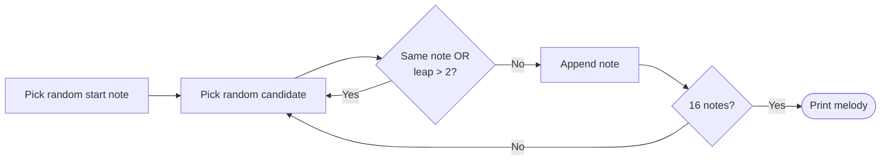

# 🎵 Melodic Pentatonic Generator & Sequencer


**Melodic Pentatonic Generator & Sequencer** is an interactive, terminal-based musical tool written in C. It serves as both an educational utility and a creative companion for songwriters and improvisers.

The application bridges music theory and algorithmic composition. It takes any of the 12 standard Western Diatonic Major scales and dynamically extracts notes to form their corresponding **Major Pentatonic scales** (the backbone of blues, rock, and jazz improvisation).

Going beyond a passive music dictionary, the project features an intelligent algorithmic sequencer. By simulating human playing constraints, it generates a flowing, naturally phrased 16-note random melody instead of chaotic, disjointed noise. It provides an excellent starting point for generative music experimentation, phrase training, or instant songwriting inspiration.

---

## 🚀 Key Features
* **Full Chromatic Scale Mapping:** Pre-configured with all 12 standard major scales, accurately preserving musical accidental spellings (sharps `#` and flats `b`).
* **Dynamic Pentatonic Derivation:** Automatically extracts the 1st, 2nd, 3rd, 5th, and 6th intervals from the root major scale using dynamic array allocation.
* **Smart Melodic Sequencing:** The built-in phrase generator avoids raw randomness, utilizing strict interval constraints to create cohesive, organic melodies.
* **Backing Track Player:** A companion program (`Backing_track.c`) loops a backing track in any of the 12 keys, so you can practice improvising over the generated pentatonic scale.
* **Interactive CLI Interface:** A user-friendly, loop-driven command-line interface that allows seamless navigation, testing, and continuous generation until explicitly closed.

---

## 🛠️ Technical Implementation & Architecture

### 1. Data Structures
The program represents musical properties using a clean, pointer-based `Scale` structure to maximize memory efficiency:
```c
typedef struct {
    char* name;      // Name of the scale (e.g., "C major")
    char* notes[7];  // Array of pointers to the 7 diatonic notes
} Scale;
```

### 2. Pentatonic Derivation
`createPentatonic()` allocates a 5-element array on the heap and picks degrees **1, 2, 3, 5, 6** of the major scale (skipping the 4th and 7th, which create half-step tension). The caller frees the array after use.
```c
char** pentatonic = malloc(5 * sizeof(char*));
pentatonic[0] = major.notes[0];  // 1st
pentatonic[1] = major.notes[1];  // 2nd
pentatonic[2] = major.notes[2];  // 3rd
pentatonic[3] = major.notes[4];  // 5th
pentatonic[4] = major.notes[5];  // 6th
```

### 3. Melodic Sequencing Algorithm
`printRandomNotes()` builds a 16-note phrase with two constraints that mimic how a player moves across the scale:
* **No repeated notes:** The next note must differ from the previous one.
* **Limited leaps:** The step between consecutive notes is at most **2 scale degrees**, so the melody moves smoothly instead of jumping randomly.



### 4. Backing Track Player
`Backing_track.c` uses the Windows multimedia API (`PlaySound` with `SND_ASYNC | SND_LOOP`) to loop the selected key's `.wav` file until a key is pressed.

---

## ⚙️ How to Use

1.  Open `Project3.sln` in **Visual Studio** (Windows, links `winmm.lib`).
2.  **Pentatonic generator** (`pentatonic.c`):
    ```text
    Enter a scale (type 'close' to quit): G major
    G major scale: G A B C D E F#
    G major pentatonic: G A B D E
    Generate a random 16-note melody? (y/n): y
    B A G A B D E D B A B D B A G A
    ```
3.  **Backing track** (`Backing_track.c`): Choose a key from 1–12 and the track loops until you press any key.

*Note: The program's prompts are in Korean. The sample output above is translated, and the melody is random on every run.*

---

## 📁 Project Structure

```text
opensw_middle/
├── pentatonic.c        # Scale table, pentatonic derivation, melody generator
├── Backing_track.c     # Backing track player (12 keys)
├── *.wav / *.mp3       # Backing track audio files per key
└── Project3.sln        # Visual Studio solution
```

---

*This project was developed to connect music theory with algorithmic composition in a simple, hands-on C program.*

**Developer:** Geonho Kim (leo6930)
