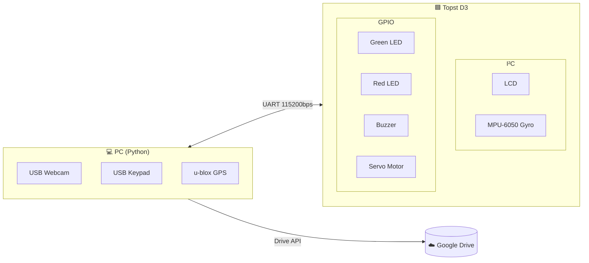
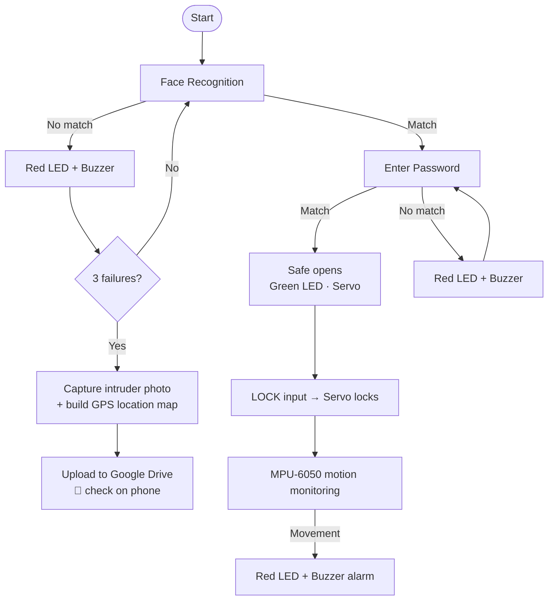

# 🔐 Face Recognition-Based Two-Factor Authentication Smart Safe

This project implements a smart safe secured by **two-factor authentication**: **face recognition with OpenCV** as the first factor and a **keypad password** as the second. A PC handles vision, GPS, and cloud upload, and a **Topst D3** board drives the LCD, LEDs, buzzer, servo lock, and motion sensor over UART. After three failed face authentication attempts, the system captures the intruder's photo and the safe's GPS location and uploads both to **Google Drive** so the owner can check them on a phone.

<p align="center">
  
  
</p>

---

## 🚀 Key Technical Features

*   **Two-Factor Authentication:**
    *   **1st Factor – Face Recognition:** Registered users' photos are encoded into **128-dimensional face embeddings** with `face_recognition` (dlib). Live frames are compared against them with a strict tolerance of **0.45** (default 0.6) to reduce false accepts.
    *   **2nd Factor – Keypad Password:** The keypad prompt appears only after face authentication succeeds.
*   **Intruder Alert System:**
    *   After **3 consecutive face authentication failures**, the current frame is saved as an intruder photo.
    *   The system parses `$GPGGA` / `$GNGGA` NMEA sentences from a u-blox GPS module and converts degrees-minutes into decimal degrees.
    *   It builds an interactive location map with **folium** and uploads both the photo and the map to **Google Drive** through a service account, so the owner can check them from a smartphone.
*   **Anti-Theft Monitoring:** An **MPU-6050** gyro sensor detects movement of the locked safe and triggers the LCD warning, red LED, and buzzer.
*   **Hardware Feedback:** A green LED and the servo motor unlock the safe on success. A red LED and the buzzer go off on any failed attempt.
*   **Low-Latency Capture:** Stale frames are flushed from the webcam buffer (`grab()` ×5, buffer size 1) so authentication always uses the latest image.

---

## 🧩 Hardware Architecture



<p align="center"></p>

---

## 🔄 Software Flow



### PC ↔ Board Serial Protocol

| Direction | Message | Meaning |
|---|---|---|
| PC → Board | `FACE` | Start face recognition (LCD prompt) |
| PC → Board | `REQ_PW` | Face verified, request password |
| PC → Board | `OK` | Password correct → unlock |
| PC → Board | `FAIL` | Face or password mismatch → alarm |
| PC → Board | `1` | Lock request |
| Board → PC | `LOCKED` | Servo lock completed |

---

## 🛠 Tech Stack

*   **Platform:** PC (Linux) + Topst D3 board
*   **Language:** Python 3
*   **Vision:** OpenCV, face_recognition (dlib)
*   **Sensors / Actuators:** USB Webcam, USB Keypad, u-blox GPS, MPU-6050, LCD (I²C), LEDs, Buzzer, Servo Motor
*   **Communication:** UART (pyserial)
*   **Cloud / Visualization:** Google Drive API, folium

---

## ⚙️ How to Use

1.  **Install dependencies:** `pip install -r requirements.txt`
2.  **Register users:** Put face photos of authorized users in `images/known/`.
3.  **Configure environment variables** (defaults are at the top of `face_auth_safe.py`):
    ```bash
    export SAFE_DRIVE_FOLDER_ID=<Google Drive folder ID>
    export SAFE_PASSWORD=<password>
    export SAFE_CREDENTIALS=credentials.json   # service account key, never commit this
    ```
4.  **Run:** `python face_auth_safe.py`, then enter `1` to start an authentication session.

*Note: This repository contains the PC-side Python code only. The Topst D3 firmware that controls the LCD, LEDs, servo, and gyro sensor is not included.*

---

## 📈 Evaluation & Discussion

*   ✅ The 128-dimensional face embeddings separated authorized users from other people reliably.
*   ⚠️ Each face authentication attempt took about **3–4 seconds**. Removing the duplicate detection and encoding step (the frame is saved to disk and then read back) should cut this time.
*   💡 A next step would be to have the motors open and close the safe door itself, not just the lock.

---

*This project was developed to build a practical two-factor safe that combines computer vision, embedded hardware control, and cloud-based intruder alerts.*

**Developer:** Geonho Kim (leo6930)

**Reference:** [ageitgey/face_recognition](https://github.com/ageitgey/face_recognition)
