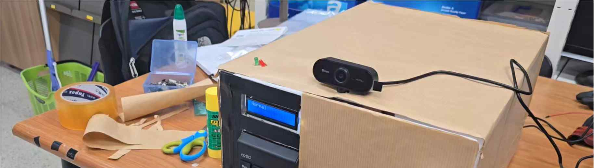
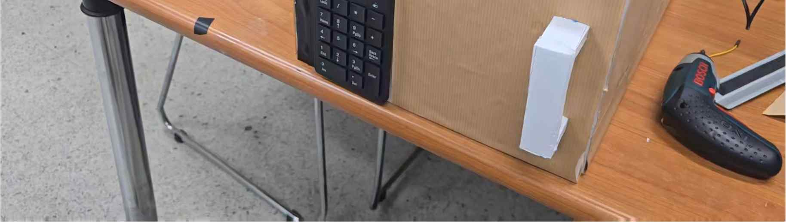
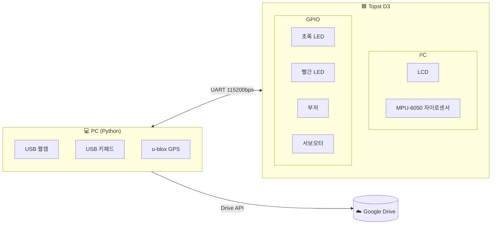
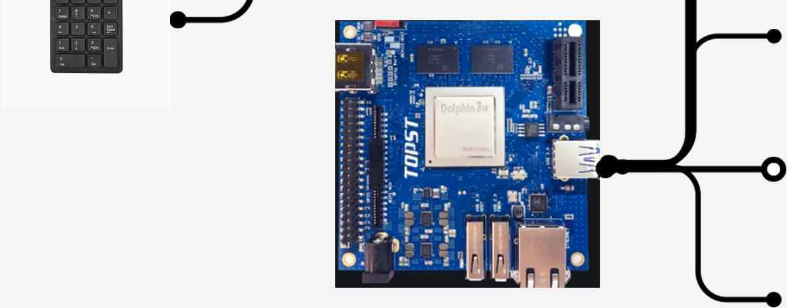
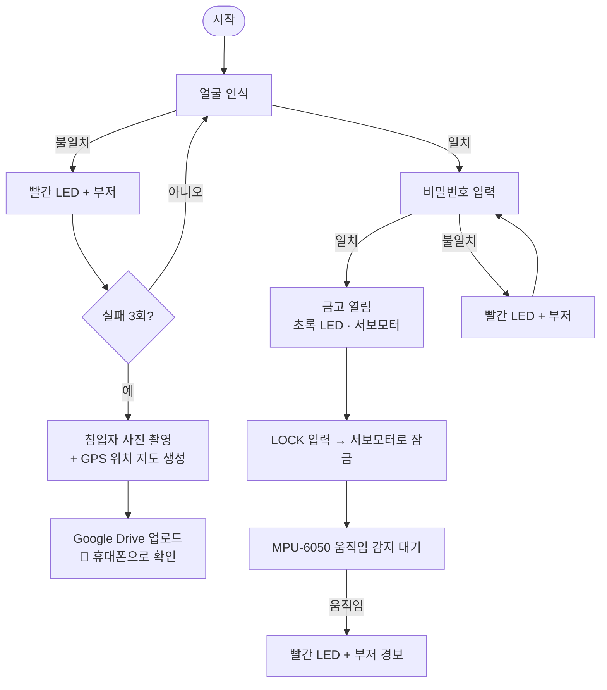

# 🔐 얼굴인식을 활용한 2단계 인증 금고 시스템
> **Face Recognition-Based Two-Factor Authentication Smart Safe (with OpenCV)**
>
> 얼굴 인식(1단계)과 키패드 비밀번호(2단계)로 금고를 여는 임베디드 보안 시스템입니다.
> 인증에 3번 실패하면 침입자의 사진과 금고의 GPS 위치를 Google Drive로 보내 주인이 휴대폰에서 바로 확인할 수 있습니다.


<p align="center">
  
  
</p>

| 항목 | 내용 |
|---|---|
| 기간 | 2025 (최종 발표 2025-06-12) |
| 팀 | 9조 · 박현, **김건호** |

---

## 📌 프로젝트 개요 (Overview)

| 기능 | 설명 |
|---|---|
| **인증 시스템** | 1차: OpenCV + `face_recognition`으로 얼굴 인식 → 2차: 키패드 비밀번호 |
| **보안 시스템** | 인증 성공 시 LCD 출력 · 초록 LED · 서보모터로 금고 열림 / 실패 시 빨간 LED · 부저 |
| **도난방지 시스템** | MPU-6050 자이로센서로 금고 움직임을 감지하면 LCD에 표시하고 LED와 부저로 경보 |
| **침입자 알림** | 얼굴 인증 3회 실패 시 침입자 사진과 GPS 위치 지도(HTML)를 Google Drive에 업로드 |

---

## 🧩 하드웨어 구성 (Hardware)



<p align="center"></p>

---

## 🔄 동작 흐름 (Software Flow)



### PC ↔ 보드 시리얼 프로토콜

| 방향 | 메시지 | 의미 |
|---|---|---|
| PC → 보드 | `FACE` | 얼굴 인식 시작 (LCD 안내) |
| PC → 보드 | `REQ_PW` | 얼굴 인증 성공, 비밀번호 입력 요청 |
| PC → 보드 | `OK` | 비밀번호 일치 → 금고 열림 |
| PC → 보드 | `FAIL` | 얼굴 또는 비밀번호 불일치 → 경보 |
| PC → 보드 | `1` | 금고 잠금 요청 |
| 보드 → PC | `LOCKED` | 서보모터 잠금 완료 |

---

## ⚙️ 핵심 구현 (Implementation)

### 1단계: 얼굴 인증
* `images/known/` 폴더에 있는 등록 사용자 사진들을 **128차원 얼굴 임베딩**으로 바꿔 둡니다.
* 웹캠 버퍼에 쌓인 오래된 프레임을 `grab()`으로 버린 뒤 가장 최근 프레임만 씁니다.
* `compare_faces(..., tolerance=0.45)`: 기본값(0.6)보다 엄격한 임계값으로 다른 사람을 본인으로 잘못 인식할 가능성을 줄였습니다.

### 2단계: 비밀번호 인증
* 얼굴 인증에 성공하면 보드로 `REQ_PW`를 보내고 키패드 입력을 받습니다.
* 비밀번호가 맞으면 금고가 열리고, 사용자가 `1`을 누르면 다시 잠깁니다.

### 침입자 알림
* 얼굴 인증이 3번 연속 실패하면 해당 프레임을 `images/invader/invader_<timestamp>.jpg`로 저장합니다.
* GPS 모듈에서 `$GPGGA`/`$GNGGA` NMEA 문장을 파싱해 위·경도(도·분 → 십진 도)를 구합니다.
* `folium`으로 금고 위치를 표시한 지도 `gps_map_<timestamp>.html`을 만듭니다.
* 서비스 계정으로 **Google Drive API**에 사진과 지도를 업로드하고, 주인은 휴대폰으로 확인합니다.

---

## 🚀 실행 방법 (How to Run)

```bash
pip install -r requirements.txt

# 환경변수 설정 (기본값은 코드 상단 참고)
export SAFE_DRIVE_FOLDER_ID=<업로드할 Drive 폴더 ID>
export SAFE_PASSWORD=<비밀번호>
export SAFE_CREDENTIALS=credentials.json   # Google 서비스 계정 키 (커밋 금지)

# 등록 사용자 얼굴 사진을 images/known/ 에 넣은 뒤
python face_auth_safe.py
```

> 이 폴더에는 PC 측 Python 코드만 있습니다. LCD, LED, 서보모터, 자이로센서를 제어하는 Topst D3 보드 측 코드는 포함되어 있지 않습니다.

---

## 📈 성능 평가 및 고찰 (Evaluation)

* ✅ `face_recognition`의 128차원 얼굴 임베딩을 써서 사람 구분 성능이 확실했습니다.
* ⚠️ 얼굴 인증 1회에 **3~4초** 정도 걸렸습니다. 얼굴 검출과 인코딩을 두 번 하는 부분(저장 후 다시 읽기)을 줄이면 개선할 수 있습니다.
* 💡 모터 제어로 금고 문 자체를 자동으로 열고 닫는 구조까지 확장하면 좋겠다는 결론을 얻었습니다.

---

## 📚 참고 (References)
* [ageitgey/face_recognition](https://github.com/ageitgey/face_recognition)
