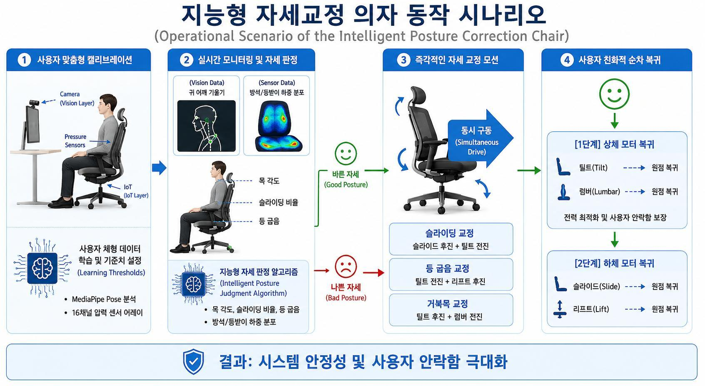
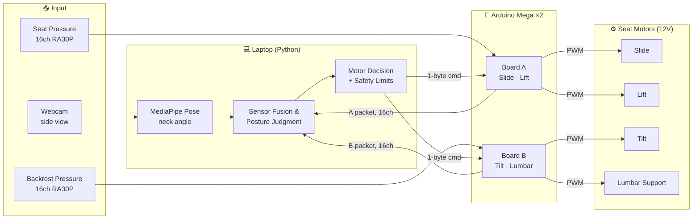
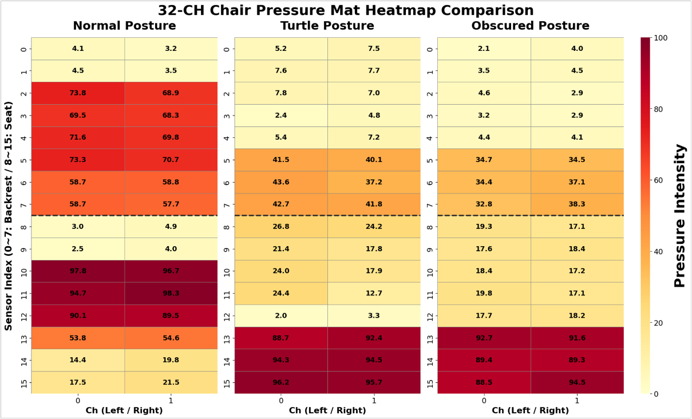
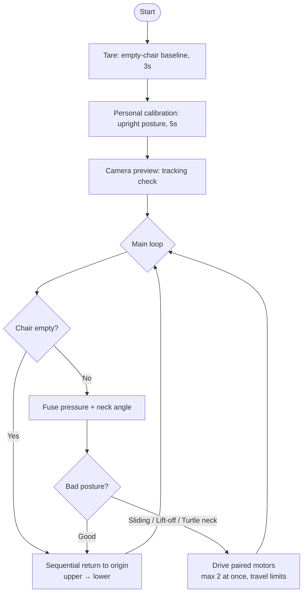

# 🪑 Intelligent Posture Correction Chair (Pressure Sensors + Camera)

This capstone design project builds a chair that **detects bad sitting posture in real time and corrects it automatically**. A webcam running **MediaPipe Pose** measures the neck angle from the side, and a **32-channel pressure sensor array** (16 on the seat, 16 on the backrest) measures how body weight is distributed. A Python controller fuses both data streams to classify **sliding, back lift-off, and turtle neck** postures. It then drives four automotive seat motors through two **Arduino Mega** boards to guide the user back into a correct posture.

  

---

## 🚀 Key Technical Features

*   **Vision-Based Neck Angle Estimation:**
    *   Uses **MediaPipe Pose** (`model_complexity=0`) to track the ear and shoulder landmarks from a side-view webcam.
    *   Computes the ear–shoulder tilt from vertical as the neck angle and ignores frames where landmark visibility is below 0.5.
    *   A **threaded camera reader** always provides the latest frame, so vision never blocks the control loop.
*   **32-Channel Pressure Mapping:**
    *   Each Arduino Mega streams 16 analog channels (10-bit ADC) as a tagged packet (`A,...` for the seat, `B,...` for the backrest) at 115200 bps.
    *   **Software tare:** At startup, the empty chair is sampled for 3 seconds to build a per-channel baseline, and readings below a noise threshold are set to zero.
*   **User-Specific Calibration:** The user sits upright for 5 seconds and the system learns a **personal shoulder-pressure reference** and **front/back seat pressure ratio**. If the shoulder or hip pressure is too low, the measurement is rejected and repeated automatically.
*   **Sensor Fusion & Posture Judgment:**
    *   **Sliding:** Front-seat (thigh) pressure exceeds the user's calibrated ratio relative to rear-seat (hip) pressure. The limit relaxes when the lift motor is raised.
    *   **Back lift-off:** Shoulder pressure on the backrest drops below 30% of the personal reference.
    *   **Turtle neck:** A smoothed score combining the normalized neck angle (weight 0.8) and the shoulder pressure loss (weight 0.4). An exponential moving average suppresses jitter. An angle over 40° triggers correction immediately.
*   **4-Axis Automatic Correction:** Each posture problem maps to a pair of motors that move simultaneously:

    | Detected Posture | Motors Driven |
    |---|---|
    | Sliding | Slide + Tilt |
    | Back lift-off | Tilt + Lift |
    | Turtle neck | Tilt + Lumbar |

*   **Safety & Stability:**
    *   **Power limit:** At most **2 motors** run at the same time to protect the power supply.
    *   **Open-loop position tracking:** Each motor's displacement is tracked by integrating its run time, with separate return-speed weights per direction. Hard travel limits are set to 5–6 seconds.
    *   **Sequential return:** When the posture is good again or the chair is empty, the **upper-body motors (tilt, lumbar) return to origin first**, followed by the lower-body motors (slide, lift).
    *   **Command deduplication:** A motor command is resent only when it changes, or every 0.3 seconds as a keep-alive.

---

## 🧩 System Architecture

### Hardware

| Component | Details |
|---|---|
| MCU | Arduino Mega ×2 (parallel processing) |
| Sensors | RA30P pressure sensors ×32 (seat 16, backrest 16), USB webcam |
| Actuators | Kia Niro EV OEM seat motors ×4 (slide, lift, tilt, lumbar) |
| Drivers | Motor drivers ×4 (PWM, R/L enable) |
| Power | 2 power supplies, 12V motor power separated from 5V logic power |

### Serial Command Protocol

| Motor | Board | FORWARD | BACKWARD | STOP |
|---|:---:|:---:|:---:|:---:|
| Slide | A | `U` | `D` | `Y` |
| Lift | A | `H` | `L` | `Z` |
| Tilt | B | `B` | `F` | `S` |
| Lumbar | B | `I` | `O` | `X` |

---

## 📊 Pressure Data Analysis

The heatmaps below compare the 32-channel pressure distribution for a normal posture, a turtle neck posture, and a slouched posture. These patterns were the basis for the fusion thresholds.

  

---

## 🔄 Control Flow

---

## 🛠 Tech Stack

*   **Language:** Python 3, Arduino (C++)
*   **Vision:** OpenCV, MediaPipe Pose
*   **Communication:** pyserial (UART, 115200 bps)
*   **Hardware:** Arduino Mega ×2, RA30P pressure sensors, motor drivers, automotive seat motors

---

## ⚙️ How to Use

1.  **Flash firmware:** Upload `firmware/board_a_slide_lift` and `firmware/board_b_tilt_lumbar` to the two Arduino Mega boards.
2.  **Install dependencies:** `pip install -r requirements.txt`
3.  **Run:** `python posture_chair.py`. Serial ports (`COM*` / `ttyACM*`) are detected automatically.
    1.  **Tare:** Stand up and leave the seat empty for 3 seconds.
    2.  **Personal calibration:** Sit upright, press `Enter`, and hold the posture for 5 seconds.
    3.  **Preview:** Check that the ear–shoulder line is tracked, then press `Enter` or `S` to start motor control.
4.  **Keys during operation:** `R` resets all motor position timers to zero, and `Q` stops all motors and quits.

---

## 📈 Conclusion & Future Work

*   ✅ Fusing MediaPipe vision data with 32-channel pressure data made **real-time posture judgment** work.
*   ✅ Personal calibration and the sequential return algorithm kept the system stable.
*   💡 The project turned an ordinary chair into an **active, intelligent chair** that guides the user toward a correct posture.
*   🔜 **Future work:** more control axes for finer spinal alignment, high-torque motors for a wider range of body weights, and smoother motor speed and UX so the correction does not feel unnatural.

---

*This project was developed as a capstone design project to explore how vision and pressure sensing can be fused into an actively correcting smart seat.*

**Developer:** Geonho Kim (leo6930)
